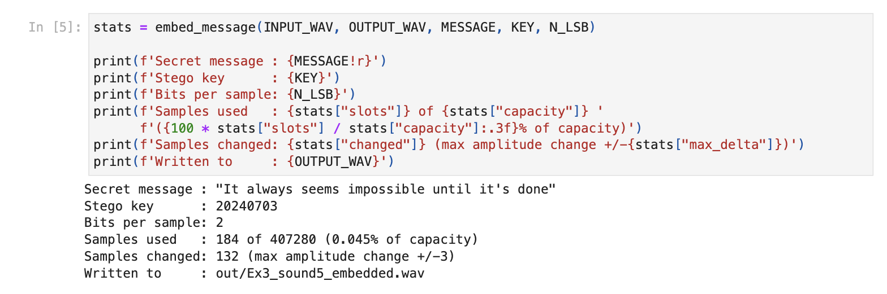
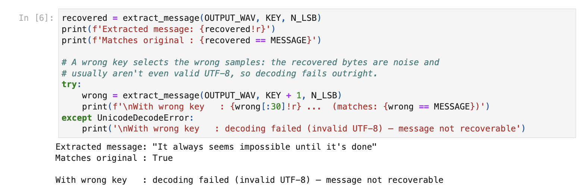

# Overview

Tasks 3.1 and
3.2 are implemented as Python notebooks: one detects and decodes a code
hidden in an ultrasonic band, the other embeds and recovers a text message
with a key-based least-significant-bit (LSB) scheme. Task 3.3 reviews a
recent diffusion-based method and compares it with LSB.

# Task 3.1: Analysis of the suspicious audio

**The problem.** Four WAV files may carry a four-number code that has been
amplitude-modulated (AM) onto an *ultrasonic* carrier and mixed into an
ordinary recording, so nothing sounds wrong on normal playback.

**Detection.** The container headers already narrow the field: the three
48 kHz files have Nyquist headroom (24 kHz) for ultrasound, whereas the
44.1 kHz file barely does. For each file, the detector measures the fraction
of spectral energy at or above 18 kHz, a region where natural recordings
hold almost nothing. `Ex3_sound4.wav` keeps **10.86 %** of its energy there against
0.006–4.25 % for the others, peaking at **19,001 Hz** (Figure 1). That is
the carrier.


**Diagnosis.** Zooming into that band shows a central carrier line flanked
by *symmetric sidebands* (Figure 2), the textbook fingerprint of amplitude
modulation: AM shifts the message spectrum up around the carrier and
mirrors it on both sides.

{width=92%}

**Decoding.** The decoder reverses the modulation in three steps: a band-pass filter
isolates the carrier; envelope detection via the analytic (Hilbert) signal
strips the carrier oscillation and leaves the message; a low-pass filter
returns it to baseband. The recovered signal shows voiced-speech harmonics
(Figure 3, right) and, played aloud, speaks the code **1891**.

```{=latex}
\begin{figure*}[t]
\centering
\includegraphics[width=\linewidth]{figures/fig-spectro.png}
\par\medskip
\refstepcounter{figure}%
\noindent\parbox{\linewidth}{\centering\footnotesize \textbf{Figure~\thefigure.}
Left: the stego spectrogram; the AM burst sits above the 18~kHz line (cyan)
and lasts only the first \(\approx\!1.6\)~s. Right: after band-pass,
Hilbert-envelope and low-pass demodulation, the code returns to the audible
band as clear voiced-speech harmonics.}
\end{figure*}
```

# Task 3.2: Embedding a hidden message

Task 3.2 embeds *"It always seems impossible until it's done"* into
`Ex3_sound5.wav` and recovers it, improving on plain LSB in three ways.
A single integer **key** seeds a pseudo-random permutation of the sample
indices, so the message bits are scattered across *non-consecutive* samples,
and only the key has to be shared, not the list of positions. Each chosen
sample carries **two** least-significant bits, doubling capacity. A 32-bit
length **header** is embedded first, so extraction is self-contained: the
receiver reads the header, learns the message length, and stops on its own.



**Results.** The message occupies **184 of 407,280 samples (0.045 %** of
capacity); only **132** samples change, each by at most **±3** out of 65,536
(Figure 4), far below the threshold of hearing. The altered samples are
sparse and scattered, and the cover and stego spectra coincide, leaving no
visible trace (Figure 5). Extraction with the correct key reproduces the
message *exactly*; a wrong key selects the wrong samples and decoding fails
on invalid UTF-8 (Figure 6), confirming that the key genuinely protects the
payload.

```{=latex}
\begin{figure*}[t]
\centering
\includegraphics[width=\linewidth]{figures/fig-stego.png}
\par\medskip
\refstepcounter{figure}%
\noindent\parbox{\linewidth}{\centering\footnotesize \textbf{Figure~\thefigure.}
Left: the cover waveform with the 132 key-selected message samples marked in
red, sparse and scattered. Right: cover and stego magnitude spectra
overlaid; the curves coincide, so the embedding leaves no visible spectral
trace.}
\end{figure*}
```



# Task 3.3: A state-of-the-art approach, diffusion-based steganography

Xi et al. (2025) propose a **diffusion-based** audio steganography
model.^[J. Xi, Z. Xia, W. Zhang, Y. Xie and L. Zhao, "Diffusion-Based Model
for Audio Steganography," *Electronics* **14**(20):4019, 2025.
<https://doi.org/10.3390/electronics14204019>.]

**Characteristics and implementation.** Two coupled modules share one
denoising-diffusion backbone: a U-Net trained to predict, and therefore
remove, the noise added to audio at each diffusion step. The *embedding*
module folds the secret bits into the model's starting noise (its latent)
and then denoises that latent into natural-sounding stego audio. A
psychoacoustic attention map, computed from an STFT, steers the noise away
from the low frequencies the ear is most sensitive to. Because the sampling
schedule is deterministic (DDIM), the chain is invertible: the *extraction*
module simply runs it backwards, from stego audio to latent, and reads the
bits out of the latent's DCT coefficient signs, exactly on a clean channel.
The framework can even *generate* the cover audio outright, needing no
natural carrier. The appendix walks through this pipeline in plain terms.

**Benefits.** The authors report near-transparent quality (PESQ 4.42, SNR
83 dB) and, critically, deep-learning steganalyzers detect the stego audio
at only **about 47–62 %**, close to the 50 % chance line, versus **about
76 %** for LSB matching. The method also survives MP3 compression, added
noise and resampling.

**Comparison with LSB.** Table 1 summarises the trade-offs.

```{=latex}
\begin{table*}[h]
\small
\begin{tabular*}{\linewidth}{@{\extracolsep{\fill}}lll@{}}
\toprule
 & \textbf{Key-based LSB (Task 3.2)} & \textbf{Diffusion (Xi et al.)} \\
\midrule
Embedding domain & time (raw sample bits) & learned deep features \\
Capacity & 2 bits per selected sample & 0.1--0.5 bits per sample tested \\
Detectability & high (LSB $\approx$76\%) & very low ($\approx$47--62\%) \\
Robustness & fragile to resampling & survives noise / MP3 \\
Shared secret & one integer key & a trained network \\
Cost & negligible, CPU & GPU training + inference \\
Clean recovery & bit-exact, free & exact but costly \\
\bottomrule
\end{tabular*}
\par\medskip
\refstepcounter{table}%
\noindent\parbox{\linewidth}{\centering\footnotesize \textbf{Table~\thetable.}
The key-based LSB scheme of Task 3.2 and the diffusion model of Xi et al.,
compared.}
\end{table*}
```

Capacity favours LSB, which can claim every cover sample; detectability
favours diffusion, and the Task 3.2 key cannot close that gap. Scattering
hides *where* the bits sit, but the statistical trace of bit replacement
survives, and a steganalyzer needs only the trace, never the key: the key
protects confidentiality, not covertness. Diffusion never leaves the trace,
because its stego audio is generated from a learned model of natural audio,
not edited after the fact. LSB therefore suits benign channels that need
simplicity and bit-exact recovery; against steganalysis or lossy
transmission, diffusion is the stronger design.

# Appendix: the diffusion pipeline in plain terms

A diffusion model learns to turn noise into realistic data. During
training, clean audio is corrupted step by step with small amounts of
Gaussian noise, and a neural network (a U-Net) learns to undo one step of
that corruption: given a noisy clip and the step number, it predicts the
noise that was added. Once trained, the network can start from pure noise and
denoise its way, step by step, to audio that sounds natural. Xi et al.
build their steganography on three consequences of this design.

*Hiding.* The secret bits are not written into an existing file sample by
sample. Instead they are folded into the starting noise, called the latent:
each bit sets the sign of one DCT coefficient of that latent (positive for
a one, negative for a zero). Running the denoising process on this shaped
latent produces the stego audio.

*Recovery.* The generator uses the deterministic DDIM variant: the random
term in each denoising step is set to zero, which turns the sampling chain
into an ordinary differential equation solved with small Euler steps. The
same latent therefore always produces the same audio, and the chain can be
run in reverse: the receiver, holding the same trained network, walks the
stego audio back to its latent, takes the DCT, and reads the signs. On a
clean channel, this recovery is exact.

*Imperceptibility.* While noise is being injected, an attention weight
decides where it may go. The audio is mapped to a time-frequency grid with
a short-time Fourier transform, a psychoacoustic model scores each bin by
how sensitive the ear is to it, and the weights make sure the perceptually
critical low frequencies are disturbed least.

The security argument follows from the construction: the stego audio is not
a modified natural recording but a sample drawn from the model's learned
distribution of natural audio, so a steganalyzer finds no processing
artefacts to latch onto. The price is practical: sender and receiver must
share the trained network itself rather than a small key, embedding and
extraction each cost many network evaluations, and noisy channels raise
the bit error rate to roughly 5--6 %.
